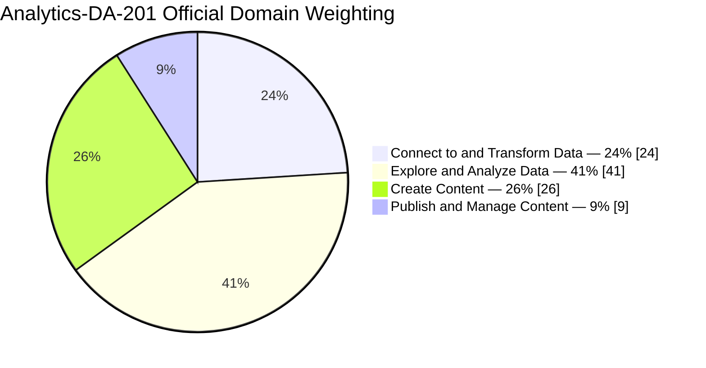
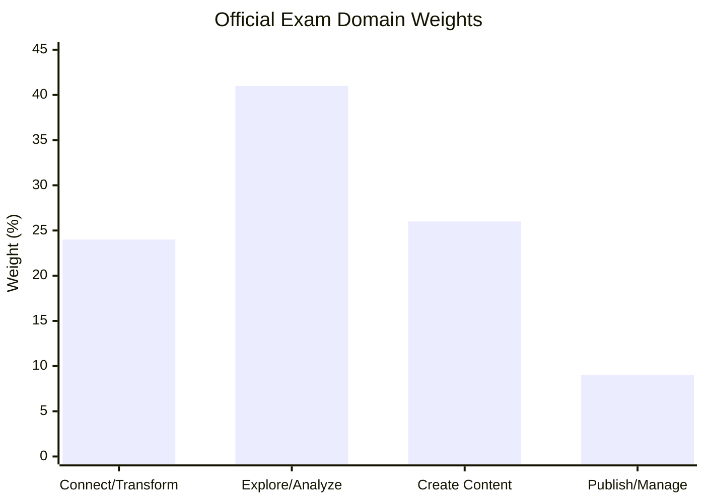
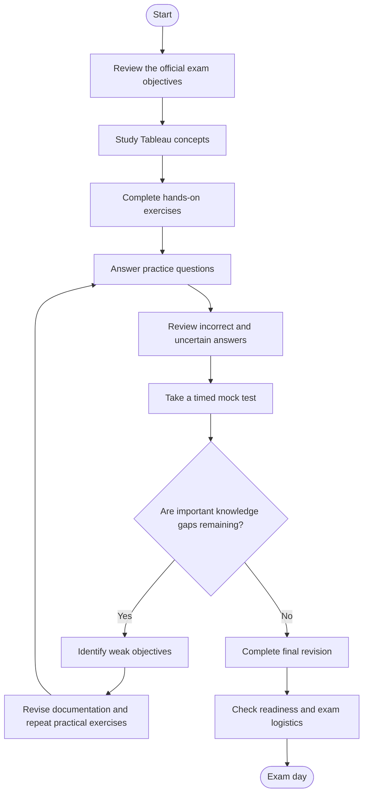
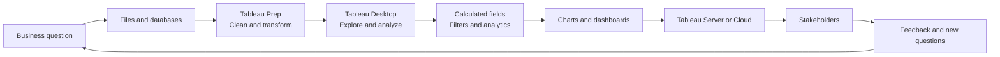
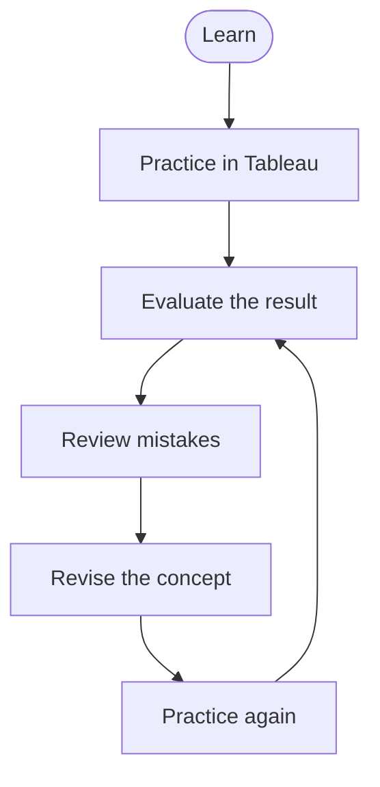
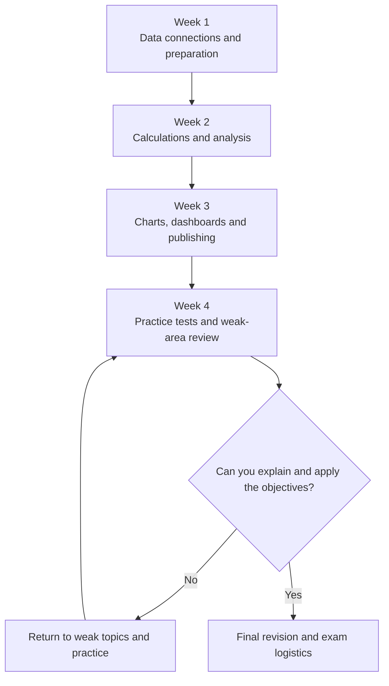

# Salesforce Certified Tableau Data Analyst (Analytics-DA-201) Study Guide

A practical, community-oriented study guide for the **Salesforce Certified Tableau Data Analyst** certification. Use it to organize your preparation, understand the official exam objectives, practice Tableau workflows, and build the analytical skills needed to turn business data into useful insights.

This repository combines an exam-domain overview, Mermaid diagrams, a suggested study roadmap, hands-on project ideas, and original practice questions. For additional preparation material, explore [CertsGate](https://certsgate.com/), an independent IT certification preparation resource, alongside Salesforce's official documentation and Trailhead learning resources.

> **Important:** Salesforce's published exam guide is the authority for exam requirements. Always review the latest version before registering. The details and domain percentages in this guide reflect the official documentation linked below and may change.

## Table of Contents

- [About the Certification](#about-the-certification)
- [Who Should Prepare?](#who-should-prepare)
- [Exam Details](#exam-details)
- [Official Exam Objectives](#official-exam-objectives)
- [Exam Domain Weightage](#exam-domain-weightage)
- [Preparation Flowchart](#preparation-flowchart)
- [Tableau Analytics Workflow](#tableau-analytics-workflow)
- [Circular Study Cycle](#circular-study-cycle)
- [Step-by-Step Preparation Guide](#step-by-step-preparation-guide)
- [Suggested Study Roadmap](#suggested-study-roadmap)
- [Hands-On Projects](#hands-on-projects)
- [Original Practice Questions](#original-practice-questions)
- [How to Review Mistakes](#how-to-review-mistakes)
- [Common Preparation Mistakes](#common-preparation-mistakes)
- [Career Relevance](#career-relevance)
- [Frequently Asked Questions](#frequently-asked-questions)
- [Official and Additional Resources](#official-and-additional-resources)
- [About CertsGate](#about-certsgate)

## About the Certification

The Salesforce Certified Tableau Data Analyst credential is intended for people who analyze data, develop visualizations, and help stakeholders make informed business decisions. The exam covers more than building attractive charts: candidates should understand how to connect to data, prepare it, analyze it, create interactive content, and publish and maintain that content through Tableau Server or Tableau Cloud.

The certification is relevant to learners developing skills in:

- Tableau Desktop and visual analytics.
- Tableau Prep and data transformation.
- Calculated fields, table calculations, and Level of Detail (LOD) expressions.
- Filters, parameters, sets, bins, and hierarchies.
- Charts, dashboards, and interactive analysis.
- Publishing, permissions, and content management in Tableau environments.

This README is an independent study companion, not a replacement for the official exam guide.

## Who Should Prepare?

This study guide may be useful for:

- Aspiring data analysts and business intelligence professionals.
- Tableau users who want to structure their exam preparation.
- Analysts who build reports and dashboards for business stakeholders.
- Professionals who work with data preparation, transformation, and visualization.
- Learners who want practical exercises to complement their existing Tableau knowledge.

The official exam guide describes an intended audience with experience using Tableau Desktop, Tableau Prep, and either Tableau Server or Tableau Cloud. It references approximately six months of experience with Tableau products and assumes foundational competencies associated with the Tableau Desktop Specialist skill level. Treat this as the guide's recommended background, and check the current exam documentation for updated expectations.

## Exam Details

The following details are reported in Salesforce's published exam guide. Verify them against the current official page before booking.

| Exam item | Published detail |
|---|---|
| Certification | Salesforce Certified Tableau Data Analyst |
| Exam code | Analytics-DA-201 |
| Question format | Multiple-choice and multiple-select |
| Scored exam content | 60 questions, plus up to 5 unscored questions |
| Time limit | 105 minutes |
| Passing score | 65% |
| Registration fee | US$200 or JPY 30,000, plus applicable taxes |
| Retake fee | US$100 or JPY 15,000, plus applicable taxes |
| Prerequisite | None |
| Delivery | Proctored testing center or online proctoring |
| Reference materials | Not permitted during the exam |
| Product version listed in the guide | Tableau 2024.2 |

**Official reference:** [Salesforce Certified Tableau Data Analyst Exam Guide](https://help.salesforce.com/s/articleView?id=005298984&language=en_US&type=1)

Fees, product versions, delivery options, and other exam policies may change. The official exam guide and certification catalog take precedence over this summary.

## Official Exam Objectives

Salesforce's published exam outline divides the exam into four domains.

### 1. Connect to and Transform Data — 24%

Study how to:

- Connect to files, relational databases, extracts, and published data sources.
- Choose between live connections and extracts.
- Assess and clean data quality issues.
- Work with relationships, joins, and unions.
- Use Tableau Prep for filtering, pivoting, aggregation, and data shaping.
- Customize field names, data types, sorting, aliases, dimensions, and measures.

**Practice goal:** Take a messy dataset, identify quality issues, transform it into a usable structure, and explain why you chose each transformation.

### 2. Explore and Analyze Data — 41%

This is the largest published domain and deserves substantial study time.

Key areas include:

- Calculated fields using date, string, logical, numeric, aggregate, and type-conversion functions.
- Table calculations such as running totals, moving averages, rankings, and percent of total.
- Filters, including context, conditional, Top N, Bottom N, include, and exclude filters.
- Parameters for interactive analysis.
- Sets, bins, groups, and hierarchies.
- Geographic analysis with symbol, density, and filled maps.
- Analytics features such as reference lines, trend lines, forecasting, and distribution bands.
- Level of Detail expressions using `FIXED`, `INCLUDE`, and `EXCLUDE`.

**Practice goal:** Given a business question, select the appropriate calculation, filter, analytical feature, or data structure and explain why it fits.

### 3. Create Content — 26%

Prepare to:

- Build common charts such as bar charts, line charts, scatter plots, histograms, maps, and box plots.
- Combine worksheets into dashboards.
- Create stories and organize story points.
- Add interactivity with filter, URL, and highlight actions.
- Use parameters and sets to support exploration.
- Format workbooks, worksheets, and dashboards.
- Improve tooltips, annotations, layout, and device-specific presentation.

**Practice goal:** Build a dashboard that answers a specific business question instead of simply displaying a collection of charts.

### 4. Publish and Manage Content on Tableau Server and Tableau Cloud — 9%

Review how to:

- Publish and share Tableau content.
- Manage published workbooks and data sources.
- Work with permissions and access.
- Keep content current using appropriate refresh and scheduling options.
- Understand the responsibilities involved in maintaining published analytical content.

Use the current official exam guide for the complete objective list. The bullets above summarize study areas and are not intended to replace the detailed outline.

## Exam Domain Weightage

The charts below reproduce the four domain percentages in the published exam guide. They describe **official exam weighting**, not a prediction of how many questions will appear from each topic.

### Domain distribution

### Compare domain sizes

### How to use the weighting

- Give **Explore and Analyze Data** substantial attention because it represents the largest domain.
- Do not neglect **Create Content**; chart selection, dashboard design, and interactivity require practical experience.
- Build a reliable foundation in **Connect to and Transform Data** before attempting complex analysis.
- Cover **Publish and Manage Content** even though its percentage is lower.
- Revisit the official outline periodically to check for changes.

Official source: [Salesforce Certified Tableau Data Analyst Exam Guide](https://help.salesforce.com/s/articleView?id=005298984&language=en_US&type=1)

## Preparation Flowchart

Use this workflow to move from understanding the exam to checking your readiness. The revision loop is intentional: a weak practice result should lead to targeted learning, not simply another attempt at the same questions.

Use official learning resources to establish the concepts, then test whether you can apply them without step-by-step instructions.

## Tableau Analytics Workflow

A data analyst's work usually begins with a business question and ends with an insight that someone can use. The diagram below illustrates a typical Tableau workflow. It is a conceptual learning diagram, not an official Salesforce architecture.

### Understand the role of each stage

| Stage | Main responsibility | Example |
|---|---|---|
| Business question | Define what needs to be understood | Why did monthly sales decline? |
| Data source | Obtain relevant records | Orders, customers, and product data |
| Data preparation | Improve data quality and structure | Correct types, remove duplicates, combine tables |
| Analysis | Calculate and investigate measures | Compare sales by region and month |
| Visualization | Communicate patterns | Trend chart and regional dashboard |
| Publishing | Share content with intended users | Publish a workbook to a managed Tableau environment |
| Feedback | Refine the analysis | Add a channel breakdown requested by stakeholders |

A strong analyst should be able to explain why a particular transformation or visualization is appropriate, not merely how to click through the interface.

## Circular Study Cycle

Certification preparation is iterative. Learn a concept, apply it, evaluate your result, understand the mistake, and then try again.

For example, if a calculated field produces the wrong sales total, investigate aggregation, data granularity, relationships, and filter behavior. Fix the underlying understanding before memorizing another formula.

## Step-by-Step Preparation Guide

### Step 1: Read the exam guide

Start with the official [Tableau Data Analyst exam guide](https://help.salesforce.com/s/articleView?id=005298984&language=en_US&type=1).

Create a checklist of the domains and detailed objectives. Mark each one as:

- **Not studied**
- **Learning**
- **Practiced**
- **Ready to explain independently**

This provides a clearer picture of your progress than counting hours alone.

### Step 2: Establish a Tableau practice environment

Use the Tableau products and learning options available to you. Review official Tableau documentation and the [Tableau Data Analyst certification preparation trail](https://trailhead.salesforce.com/content/learn/modules/cert-prep-tableau-data-analyst/get-started-with-tableau-data-analyst-certification-prep).

Work with datasets that let you practice:

- Data connections and extracts.
- Joins, relationships, and unions.
- Cleaning and reshaping records.
- Calculations and aggregation.
- Dashboard interactions.
- Publishing and access management, where available.

Check the current licensing, product access, and installation requirements before choosing a particular environment.

### Step 3: Learn data preparation before complex analysis

Practice identifying missing values, duplicate records, incorrect data types, inconsistent categories, and mismatched keys.

Then compare common data-combination techniques:

| Technique | Typical use |
|---|---|
| Join | Combine columns from related tables using matching keys |
| Union | Append records from tables with compatible structures |
| Relationship | Define how tables relate while allowing Tableau to handle queries according to the analysis |
| Pivot | Reshape data between wide and long layouts when appropriate |
| Aggregation | Summarize records at a chosen level of detail |

The correct choice depends on the data structure and analytical question. Practice explaining possible consequences, including duplicate rows and changed aggregation results.

### Step 4: Develop calculation fluency

Write calculations yourself rather than relying only on existing examples.

Practice:

- Date differences and date truncation.
- String cleanup and text comparisons.
- Conditional expressions.
- Numeric calculations and aggregation.
- Running totals and percent-of-total calculations.
- `FIXED`, `INCLUDE`, and `EXCLUDE` LOD expressions.

Pay attention to the difference between row-level calculations, aggregate calculations, and table calculations. Many analysis errors arise from using the right-looking formula at the wrong level of detail.

### Step 5: Build complete visualizations

For each business question, decide which visual form communicates the answer most clearly.

- Use a line chart for change over time.
- Use a bar chart to compare categories.
- Use a scatter plot to investigate relationships between numerical measures.
- Use a map when geographic differences matter.
- Use a dashboard when users need several coordinated views.

These are general recommendations, not absolute rules. Consider the data, audience, and question before selecting a chart.

### Step 6: Practice publishing and management

Review how published workbooks and data sources are shared and maintained. Understand the difference between creating a local visualization and making content available to others in a managed environment.

If you have access to Tableau Server or Tableau Cloud, practice publishing a workbook and reviewing its permissions and refresh requirements.

### Step 7: Test understanding with questions

Use practice questions after studying the related concept. For every wrong or uncertain answer:

1. Identify the relevant exam objective.
2. Explain why the chosen answer was incorrect or incomplete.
3. Review the related documentation.
4. Reproduce the concept in Tableau when practical.
5. Attempt a different scenario to confirm understanding.

Independent resources such as [CertsGate](https://certsgate.com/) can supplement this process. Check the relevance and currency of third-party materials against the official objectives.

## Suggested Study Roadmap

The following is an **independent four-week plan**, not an official Salesforce schedule. Adapt it to your experience, available study time, and diagnostic results.

| Week | Primary focus | Suggested deliverable |
|---|---|---|
| 1 | Data connections, data quality, joins, unions, Tableau Prep | A clean dataset with documented transformations |
| 2 | Calculated fields, filters, table calculations, LOD expressions | A workbook answering several analytical questions |
| 3 | Charts, dashboards, actions, publishing and management | An interactive dashboard and publishing notes |
| 4 | Practice questions, timed mock tests, weak-area review | An objective-by-objective readiness checklist |

If you already use Tableau regularly, you may move through familiar material quickly. Spend the saved time on less familiar objectives rather than skipping the official outline.

## Hands-On Projects

Practical work helps connect exam terminology to actual decisions. The projects below are independent exercises, not official exam tasks.

### Project 1: Sales performance dashboard

**Goal:** Investigate changes in sales performance.

Build a dashboard that includes:

- Sales over time.
- Sales by product category.
- Regional comparisons.
- Filters for date, region, and category.
- A calculated measure such as profit margin, where the dataset supports it.

**Skills practiced:** Data preparation, calculations, chart selection, dashboard layout, and interactivity.

### Project 2: Data-quality investigation

**Goal:** Prepare a messy dataset for analysis.

Introduce or identify:

- Missing values.
- Duplicate records.
- Inconsistent date formats.
- Inconsistent category names.
- Invalid or unexpected numeric values.

Use Tableau Prep or another suitable supported workflow to clean and reshape the data. Document what changed and why.

**Skills practiced:** Data profiling, cleaning, transformations, and data-quality reasoning.

### Project 3: Customer retention analysis

**Goal:** Explore how customer activity changes over time.

Create a dataset and define a clear retention measure. Analyze customer activity by cohort or time period, ensuring the definition is consistent and supported by the available fields.

**Skills practiced:** Date calculations, aggregation, filters, analytical reasoning, and communicating limitations.

### Project 4: Interactive operations dashboard

**Goal:** Help an operations team identify delays or bottlenecks.

Create views for processing time, status, location, and workload. Add filters or actions that allow users to investigate a specific category or period.

**Skills practiced:** Dashboard design, interactive actions, parameters where appropriate, and business-focused analysis.

### Project 5: Publish and maintain a workbook

**Goal:** Understand the lifecycle of a published Tableau asset.

Where your environment permits, publish a workbook, review access settings, and document the data source and refresh approach. If you lack access to a publishing environment, create a written deployment and maintenance plan using the official documentation.

**Skills practiced:** Publishing, permissions, content maintenance, and communication.

## Original Practice Questions

The questions below are original learning exercises written for this repository. They are **not official Salesforce questions**, and they do not reproduce or claim to predict the live exam.

Try answering each question before opening its explanation.

<strong>Question 1: Combining records</strong>

You have monthly sales files with the same columns and compatible data types. You want one dataset containing records from all months. Which operation is usually the most appropriate?

A. Union  
B. Create a hierarchy  
C. Add a reference line  
D. Create a dashboard action

**Answer: A — Union**

A union appends rows from compatible tables. A join combines columns based on a matching condition, so it solves a different problem.

<strong>Question 2: Analyzing trends</strong>

A stakeholder wants to see whether weekly revenue is increasing or decreasing. Which visualization is a strong starting point?

A. Pie chart  
B. Line chart  
C. Packed bubbles  
D. Text table only

**Answer: B — Line chart**

A line chart makes change over an ordered time axis easy to follow. The final choice should still account for the dataset and the audience's needs.

<strong>Question 3: Interactive scenarios</strong>

A user should be able to change an input value and explore how a calculation or view responds. Which Tableau feature is designed to support this type of interaction?

A. Parameter  
B. Union  
C. Data extract  
D. Field alias

**Answer: A — Parameter**

Parameters let users supply values that can be used in calculations, filters, reference lines, and other supported features.

<strong>Question 4: Table calculations</strong>

You want to display each category's share of the total sales represented in a view. Which calculation is a reasonable option to investigate?

A. Percent of total  
B. String replacement  
C. Data-source rename  
D. Union

**Answer: A — Percent of total**

A percent-of-total table calculation expresses a value as a proportion of a relevant total. Its result depends on the view's dimensions and the calculation's addressing and partitioning settings.

<strong>Question 5: Data quality</strong>

A date field contains strings in inconsistent formats, and some records cannot be interpreted as dates. What should you do first?

A. Publish the workbook immediately  
B. Inspect the values and correct the data type and invalid records  
C. Add more dashboard colors  
D. Replace the date field with a random number

**Answer: B — Inspect and correct the data**

Understand the source values and identify how invalid records should be handled before building time-based calculations or visualizations.

<strong>Question 6: Dashboard interactivity</strong>

A dashboard user selects a region in one view and wants another view to respond to that selection. Which capability should you investigate?

A. Dashboard filter or action  
B. Field alias  
C. Data type formatting only  
D. Workbook filename

**Answer: A — Dashboard filter or action**

Dashboard filters and actions can coordinate views. Choose the mechanism that matches the intended interaction and test how it affects the other views.

<strong>Question 7: Level of Detail</strong>

A calculation must evaluate a measure at a specified dimension level independently of the dimensions currently shown in the view. Which Tableau feature should you investigate?

A. A FIXED Level of Detail expression  
B. A dashboard title  
C. A field alias  
D. A worksheet color palette

**Answer: A — A FIXED LOD expression**

A `FIXED` expression computes a result using the dimensions specified in the expression. Its interaction with filters and the rest of the view should be understood before using it.

<strong>Question 8: Readiness assessment</strong>

You score well on practice questions but cannot explain why your selected answers are correct. What is the most useful next step?

A. Memorize the answer letters  
B. Stop studying immediately  
C. Review the underlying concepts and reproduce relevant workflows  
D. Ignore the official objectives

**Answer: C — Review and reproduce the concepts**

A practice score is more informative when you understand the reasoning behind the answers and can apply the same concepts to a new scenario.

### How to use practice questions effectively

- Attempt questions before checking explanations.
- Explain why the correct answer fits the scenario.
- Explain why each alternative is less appropriate.
- Map mistakes to the official exam objectives.
- Recreate technical concepts in Tableau where possible.
- Use timed mock tests to identify pacing issues and remaining knowledge gaps.

Practice questions should support learning, not replace hands-on work or official documentation.

## How to Review Mistakes

Maintain a simple error log throughout your preparation.

| Date | Topic | Mistake or uncertainty | Correct concept | Next action |
|---|---|---|---|---|
| Example | Data relationships | Unexpectedly high totals | Review data grain and relationship behavior | Rebuild a small example |
| Example | LOD expressions | Wrong level of detail | Review the selected dimensions and filter interaction | Test alternative expressions |
| Example | Dashboard actions | A selection does not affect the intended view | Review action configuration and target sheets | Reconfigure and retest |

The examples above illustrate how to maintain the log; they are not claims about actual exam questions.

Review recurring mistakes first. If you repeatedly confuse joins and unions, for instance, work with sample tables until you can explain the difference and predict how each operation changes the result.

## Common Preparation Mistakes

### Studying only chart types

Visualization matters, but the official outline also covers data transformation, calculations, analysis, and publishing. Balance your preparation across all four domains.

### Memorizing formulas without understanding them

Learn what a calculation does, how its result depends on the data, and what happens when filters or dimensions change.

### Ignoring data granularity

A dashboard can look convincing while showing incorrect totals. Check row counts, relationships, aggregation levels, and duplicate records when results seem unusual.

### Treating every data-combination method as interchangeable

Joins, unions, and relationships serve different purposes. Practice choosing among them using realistic data structures.

### Repeating mock tests without reviewing errors

A repeated score does not necessarily mean your understanding has improved. Investigate wrong and uncertain answers before taking another test.

### Using outdated preparation material

Product interfaces, supported features, exam objectives, and exam policies may change. Compare third-party explanations with the current official documentation.

### Neglecting publishing and management

Do not leave the lowest-weighted domain until the end without reviewing it. You should still understand the concepts listed in the official outline.

## Career Relevance

Tableau data analysis skills can be useful in roles that involve reporting, business intelligence, data visualization, and decision support. The certification can provide a structured way to demonstrate knowledge of Tableau-related tasks, but a credential alone does not establish proficiency in every real-world situation.

Practical projects can strengthen your understanding by showing how you:

- Translate business questions into measurable analytical tasks.
- Prepare and validate data before drawing conclusions.
- Select appropriate calculations and visualizations.
- Build dashboards that stakeholders can interpret.
- Communicate assumptions and limitations.
- Publish and maintain content responsibly.

Keep project examples based on data you are permitted to use, and clearly explain your own contribution.

## Frequently Asked Questions

### What is the Analytics-DA-201 exam?

It is the exam associated with the Salesforce Certified Tableau Data Analyst certification. Its published objectives cover data preparation, analysis, content creation, and publishing and management.

### Are there prerequisites?

The published exam guide lists no formal prerequisite. However, it describes a target audience with practical Tableau experience. Confirm current requirements in the official documentation.

### How long is the exam?

The published guide lists 105 minutes. Verify the current time limit before registering.

### What is the passing score?

The published guide lists a passing score of 65%. Always check the latest official exam guide for current details.

### Which domain deserves the most study time?

Explore and Analyze Data carries the largest published weighting at 41%. Your personal study plan should also account for your existing strengths and weaknesses.

### Should I practice in Tableau or only read documentation?

Use both. Documentation helps establish correct concepts, while practical exercises reveal whether you can apply them and recognize unexpected results.

### Are the questions in this repository official exam questions?

No. The practice questions included here are original educational examples created to reinforce concepts. They are not official, leaked, or guaranteed to appear on the exam.

### Where can I find official study material?

Start with the official exam guide and Salesforce Trailhead preparation resources listed below.

### Can CertsGate replace official documentation?

No. CertsGate can be used as an independent supplementary resource. Official documentation should remain the authority for current exam objectives, product behavior, and exam policies.

## Official and Additional Resources

Use these resources to confirm exam requirements and develop practical skills.

### Official Salesforce resources

1. **[Salesforce Certified Tableau Data Analyst Exam Guide](https://help.salesforce.com/s/articleView?id=005298984&language=en_US&type=1)**  
   Exam format, target audience, objectives, domain percentages, and recommended preparation.

2. **[Salesforce Certified Tableau Data Analyst — Certification Catalog](https://trailheadacademy.salesforce.com/certificate/exam-tableau-data-analyst---Analytics-DA-201)**  
   Certification overview and published exam details.

3. **[Tableau Data Analyst Certification Preparation on Trailhead](https://trailhead.salesforce.com/content/learn/modules/cert-prep-tableau-data-analyst/get-started-with-tableau-data-analyst-certification-prep)**  
   Guided learning related to the exam domains.

4. **[Salesforce Credentials Overview](https://trailhead.salesforce.com/content/learn/modules/salesforce-credentials-quick-look/get-familiar-with-salesforce-credentials-on-trailhead)**  
   Background on Salesforce certifications and the credential program.

5. **[Tableau Help](https://help.tableau.com/)**  
   Product documentation for data connections, calculations, visualizations, dashboards, and related workflows.

6. **[Tableau Training and Learning](https://www.tableau.com/learn/training)**  
   Additional learning options for Tableau users.

### Independent supplementary preparation

- **[CertsGate](https://certsgate.com/)** — Explore available certification study guides, practice questions, and other preparation material. Check that any resource you use matches the current Analytics-DA-201 objectives.

Use third-party materials to test your understanding, then return to official sources when you need to confirm a technical detail or exam requirement.

## About CertsGate

[CertsGate](https://certsgate.com/) is an independent IT certification preparation resource. Depending on the materials available for a certification, learners may use study guides, practice questions, or mock-test-style exercises to reinforce concepts and identify areas for revision.

For Analytics-DA-201 preparation, supplementary questions are most useful when they encourage you to explain Tableau behavior, reason through a scenario, and revisit the relevant official objective. Pair any third-party material with current Salesforce documentation and hands-on practice.

CertsGate is referenced here as an independent resource; this repository does not claim that it is an official Salesforce or Tableau partner.
